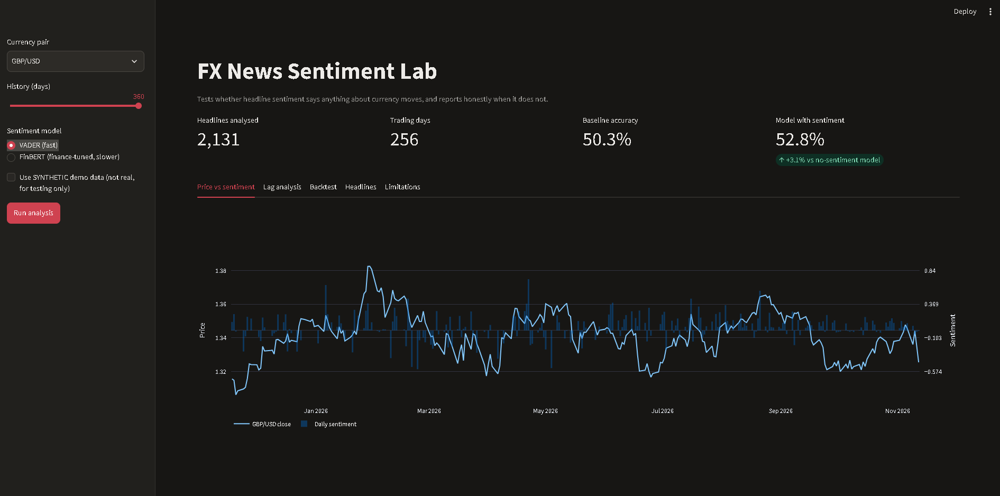
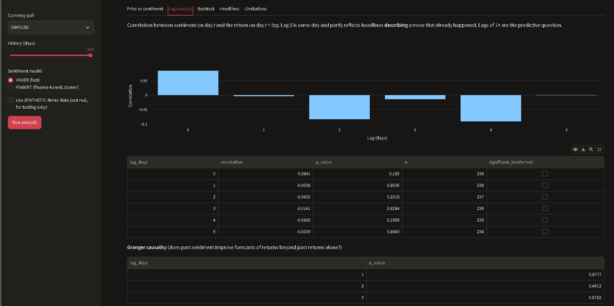
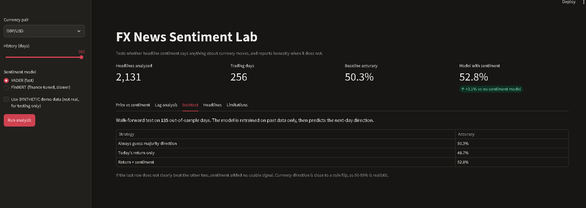

# FX News Sentiment Lab

**Live demo:** https://your-app-link.streamlit.app

An interactive Streamlit dashboard that tests a simple question: **does news sentiment help predict currency moves?** It reports honestly when the answer is no.





## What it does
1. Pulls daily FX prices (Yahoo Finance) and weekly-windowed news headlines (Google News RSS) for USD/MYR, EUR/USD, USD/JPY or GBP/USD.
2. Scores every headline with NLP (VADER with a finance lexicon, or FinBERT).
3. Aggregates sentiment per trading day (weekend news rolls to Monday).
4. Tests the relationship three ways:
   - **Lag correlations** (sentiment on day t vs return on day t+k) with a Bonferroni correction for testing several lags
   - **Granger causality**: does past sentiment improve return forecasts beyond past returns alone?
   - **Walk-forward backtest** of next-day direction, comparing a majority-class baseline, a returns-only model and a returns + sentiment model, all trained on past data only

## Run it
```bash
pip install -r requirements.txt
streamlit run app.py
```
Tick "synthetic demo data" in the sidebar to try the app offline. That data has a planted effect and is for testing only.

Test the analysis code: `python test_pipeline.py` (checks the pipeline can detect an effect that was deliberately planted in synthetic data).

## Design decisions
- **No look-ahead**: the backtest retrains on past data only and predicts the *next* day.
- **Control model**: sentiment only counts as useful if it beats a model that never sees it.
- **Multiple-testing correction**: several lags are tested, so p < 0.05 alone would produce false positives.
- **Caching**: headlines are cached to `cache/` so reruns are fast.

## Limitations
- General sentiment is not currency-directional ("Fed hikes" is bullish for USD but reads negative).
- Headlines often describe moves that already happened.
- Google News RSS gives a sample of coverage, not the full news flow.
- No transaction costs. This is research, not a trading system.

## Ideas for extension
- Pair-aware sentiment (fine-tune on labelled FX headlines)
- Add a Malay-language headline source for USD/MYR
- Deploy on Streamlit Community Cloud or AWS with Docker

- ## Results (USD/MYR, 180 days, VADER sentiment)

| Test | Result |
|---|---|
| Headlines analysed | 907 |
| Trading days | 128 |
| Lag-1 correlation | r = -0.191, p = 0.032 |
| Significant after multiple-testing correction? | No (threshold p < 0.008) |
| Walk-forward accuracy: baseline | 40.3% |
| Walk-forward accuracy: sentiment model | 52.2% |
| Gap vs model without sentiment | +7.5 points |

**Conclusion:** I found no statistically reliable evidence that news sentiment predicts next-day USD/MYR moves. The lag-1 correlation was weak and did not survive correction for testing several lags. The sentiment model scored higher in the backtest, but with about 65 test days the difference is within the range expected from chance.

**What I would do next:** extend the history to 365+ days, use a finance-tuned model (FinBERT), and make sentiment currency-specific so that "Fed hikes" counts as bullish for USD.
